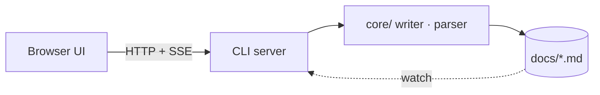
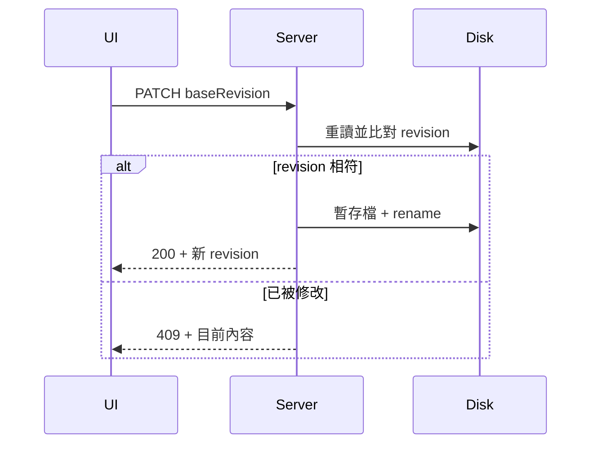

# Architecture

Nodit v1 是一個本地優先的決策與工作關聯圖。這份文件是 demo 專案的架構說明；文中的 ADR-001、MS-01、T-003 這類代號會連到對應的卡片。

## 概觀

瀏覽器 UI 只透過 `ProjectClient` 存取資料，實際讀寫由本地 CLI server 負責（決策見 ADR-001、ADR-003）。資料存在專案的 markdown 檔案裡，原本的 localStorage 方案記錄在 ADR-002，之後的擴充方向是 ADR-004。



## 主要元件

| 元件 | 職責 | 相關卡片 |
| --- | --- | --- |
| Canvas | 卡片與連線的互動畫布 | T-001、T-002 |
| Inspector | 欄位、段落與連線編輯 | T-003 |
| Writer | revision 檢查與最小 diff 寫入 | MS-01 |

### 寫入流程



### 程式碼裡的代號不會被連結

在 code span 裡寫 `ADR-001`，或在程式碼區塊裡：

```ts
const decision = 'ADR-001' // 不會變成連結
```

連結文字裡的代號也不會再包一層連結：[React Flow（ADR-001 的依據）](https://reactflow.dev)。

## 待辦

> 狀態轉換規則在 T-004，篩選搜尋在 T-005，都屬於 MS-02。ADR-099 是不存在的代號，會顯示成刪除線。
