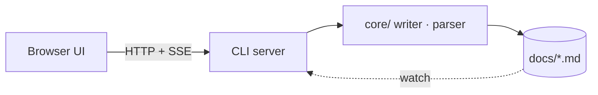
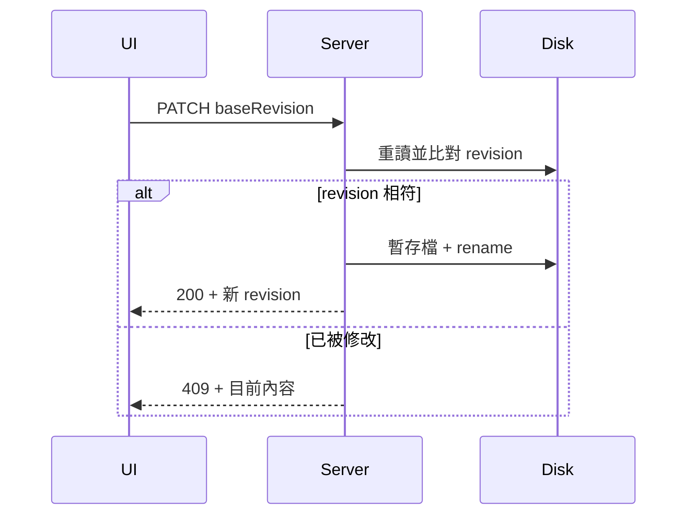

# Architecture

Nodit v1 是一個本地優先的決策與工作關聯圖。這份文件是 demo 專案的架構說明；文中的 ADR-001、MS-01、T-003 這類代號會連到對應的卡片。

## 概觀

瀏覽器 UI 只透過 `ProjectClient` 存取資料，實際讀寫由本地 CLI server 負責（決策見 ADR-001、ADR-003）。資料存在專案的 markdown 檔案裡，原本的 localStorage 方案記錄在 ADR-002，之後的擴充方向是 ADR-004。



## 主要元件

| 元件 | 職責 | 相關卡片 |
| --- | --- | --- |
| Canvas | 卡片與連線的互動畫布 | T-001、T-002 |
| Inspector | 欄位、段落與連線編輯 | T-003 |
| Writer | revision 檢查與最小 diff 寫入 | MS-01 |

### 寫入流程



### 程式碼裡的代號不會被連結

在 code span 裡寫 `ADR-001`，或在程式碼區塊裡：

```ts
const decision = 'ADR-001' // 不會變成連結
```

連結文字裡的代號也不會再包一層連結：[React Flow（ADR-001 的依據）](https://reactflow.dev)。

## 專案結構

程式碼分成三層：`core/` 是不依賴 HTTP 與瀏覽器的檔案讀寫邏輯，`server/` 把它包成 CLI 與本地 API，`src/` 是瀏覽器 UI。UI 不碰 `core/` 的檔案讀寫，只共用型別、領域規則與純函式（例如 `inferLinkKind`、`diffLines`）。

```nodit-tree
bin/
  nodit.mjs                全域 nodit 指令的入口，透過 tsx 載入 `server/cli.ts`
core/                      檔案格式與寫入規則，server 和 CLI 共用
  domain.ts                卡片種類、status、關聯種類等領域常數
  config.ts                讀取 `nodit.config.json`，提供預設路徑
  protocol.ts              server 與 UI 之間的 payload 型別
  frontmatter.ts           拆出 frontmatter 與正文，偵測換行符號
  sections.ts              找段落標題、替換段落內容
  parse.ts                 把 markdown 解析成卡片
  scan.ts                  掃描卡片資料夾、跨檔驗證（重複 ID、懸空關聯）、讀 layout
  edit.ts                  以最小 diff 修改欄位
  diff.ts                  產生行差異
  writer.ts                revision 檢查、暫存檔 + rename 寫入、配發 ID（見 MS-01）
  owner.ts                 寫入鎖與 owner 資訊，確保同一時間只有一個寫入者
  scope.ts                 限制讀寫路徑不能跳出專案目錄
  init.ts                  `nodit init` 的計畫與套用
  templates.ts             設定檔、AI 指令檔、skills、本文件的範本
  import.ts                匯入舊版 localStorage JSON（見 ADR-002），支援中斷續跑
server/                    CLI 與本地 API
  cli.ts                   解析 `nodit`、`init`、`new`、`import` 指令
  server.ts                HTTP 路由與 `dist/` 靜態檔
  project.ts               用 chokidar 監聽檔案，維護專案快照與診斷
  events.ts                SSE 推播，通知 UI 有檔案變動
src/                       React UI
  main.tsx                 進入點
  App.tsx                  整體版面，切換 Graph Canvas 與 Architecture
  store.ts                 zustand store（見 ADR-003），集中管理卡片、選取、主題與操作
  data/                    與 server 溝通
    client.ts              `ProjectClient` 介面
    httpClient.ts          `ProjectClient` 的 HTTP 實作
    sync.ts                SSE 同步與 revision 比對
    drafts.ts              Inspector 的未存草稿與衝突
  nodes/                   React Flow 的卡片節點與連線（見 ADR-001）
  components/              Header、Sidebar、Toolbar、Inspector、Init 面板、對話框
  architecture/            本頁：markdown、mermaid 與資料夾結構渲染
  presentation.ts          顯示用文字與排序
  types.ts                 UI 型別
  hooks.ts                 共用 hooks
  styles.css               全站樣式與主題變數
tests/                     vitest 測試
docs/decisions/            Nodit 自己的開發決策紀錄
examples/demo/             開發用的 demo 專案，`npm run dev:server` 開的就是它
index.html                 Vite 入口
vite.config.ts             Vite 設定
```

### 使用者專案裡的檔案

`nodit init` 之後，被 Nodit 讀寫的專案會有這些檔案（路徑可在 `nodit.config.json` 改）：

| 路徑 | 內容 | 進 git |
| --- | --- | --- |
| `nodit.config.json` | 卡片資料夾與本文件的路徑 | 是 |
| `docs/decisions/`、`docs/milestones/`、`docs/tasks/` | ADR、Milestone、Task 卡片 | 是 |
| `docs/ARCHITECTURE.md` | 本頁的內容 | 是 |
| `.nodit/layout.json` | 卡片在畫布上的座標 | 是 |
| `.nodit/writer.lock`、`owner.json`、`token` | 執行中的寫入鎖與 session 資訊 | 否 |

### 要找什麼，去哪裡

- 改卡片的 frontmatter 欄位或段落格式：`core/domain.ts`、`core/parse.ts`、`core/edit.ts`。
- 改寫入、衝突、鎖的行為：`core/writer.ts`、`core/owner.ts`。
- 新增 API：`server/server.ts`，UI 端對應加在 `src/data/client.ts` 與 `httpClient.ts`。
- 新增 CLI 指令：`server/cli.ts`。
- 改 init 產生的檔案內容：`core/templates.ts`。
- 改卡片外觀：`src/nodes/CardNodeView.tsx`；改編輯面板：`src/components/Inspector.tsx`。

## 待辦

> 狀態轉換規則在 T-004，篩選搜尋在 T-005，都屬於 MS-02。ADR-099 是不存在的代號，會顯示成刪除線。
